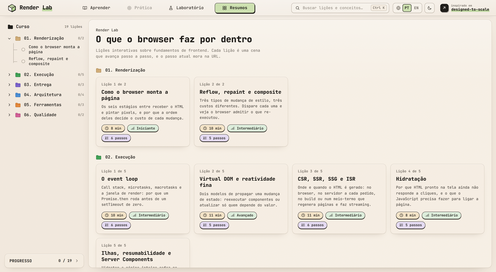
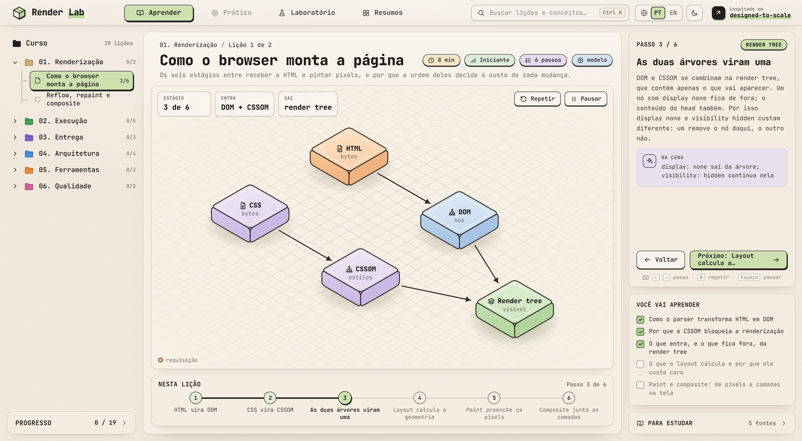
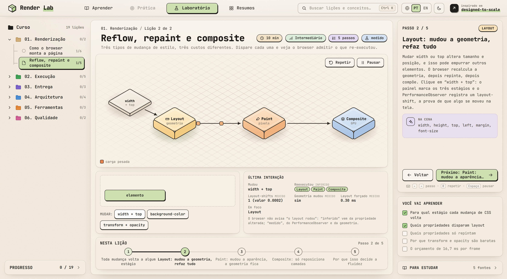
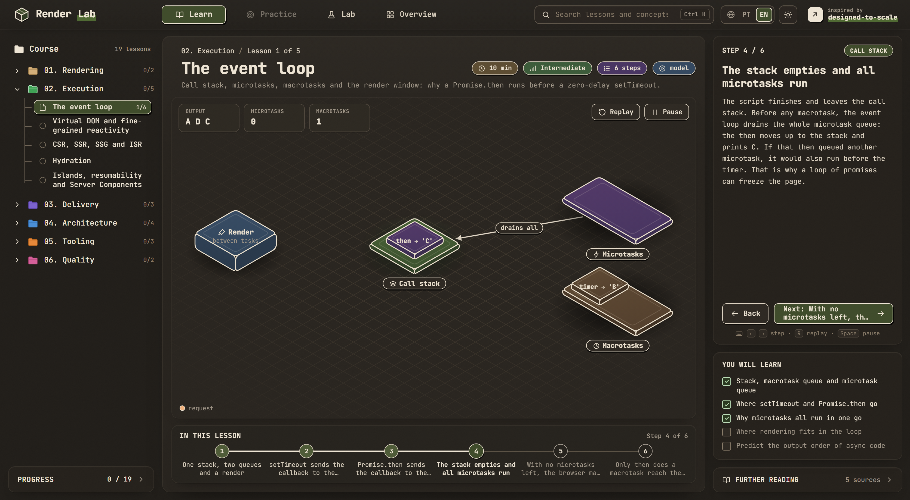

<div align="center">

# 🧪 Render Lab

**Plataforma interativa para estudar e visualizar os conceitos fundamentais de engenharia frontend.**  
*Interactive platform to study and visualize core frontend engineering concepts under the hood.*

[](#)
[](#)
[](#)
[](#)
[](#)
[](#)
[](#)

[**🇧🇷 Português**](#-português) · [**🇺🇸 English**](#-english) · [**📸 Screenshots**](#-screenshots--prints-da-aplicação)

> 💡 **Inspiração / Reference:** Este projeto foi inspirado e baseado na experiência visual e interativa do [**Designed to Scale**](https://designed-to-scale.vercel.app/).

</div>

---

## 📸 Screenshots / Prints da Aplicação

| Visão Geral do Catálogo (6 Módulos · 19 Lições) | Palco Isométrico Passo a Passo (`rendering-path`) |
| :---: | :---: |
|  |  |
| **Laboratório Interativo com Medição Real (`PerformanceObserver`)** | **Modo Escuro & Internacionalização (`EN` · `event-loop`)** |
|  |  |

---

# 🇧🇷 Português

## Sobre o Projeto

O **Render Lab** é um projeto educacional e interativo criado para **estudar, experimentar e visualizar os conceitos fundamentais de frontend** — desde o momento em que o navegador recebe os bytes do HTML até modelos modernos de hidratação, reatividade, cache no cliente, bundlers, testes e acessibilidade.

Em vez de textos estáticos ou slides, **cada lição é uma cena isométrica viva que avança passo a passo**:
- **Palco Isométrico Coreografado**: Entidades, árvores, filas, servidores e camadas ganham forma em um piso isométrico com fluxos de pacotes em tempo real.
- **Laboratório no Próprio Navegador**: Onde o conceito permite medição direta (como em *Reflow, repaint e composite*), o leitor dispara mutações reais de CSS e observa o próprio navegador reportar `layout-shifts`, alteração geométrica e tempo de layout forçado via `PerformanceObserver`.
- **Bilíngue de Ponta a Ponta (`PT · EN`)**: Toda a interface, as 19 lições, os rótulos das cenas isométricas e as notas das referências bibliográficas estão disponíveis em Português e Inglês com troca instantânea.
- **Curadoria de Fontes Oficiais**: Cada lição termina com um cartão **"Para estudar"**, reunindo especificações da W3C/WHATWG, documentação da MDN, artigos do web.dev e textos originais dos autores das ferramentas.

---

## Referência e Inspiração

A direção visual, a distribuição espacial da tela e a mecânica de aprendizado guiado por cenas isométricas foram diretamente inspiradas no projeto [**Designed to Scale**](https://designed-to-scale.vercel.app/).

Enquanto o *Designed to Scale* explora arquitetura de sistemas distribuídos e escalabilidade de backend, o **Render Lab** traz essa mesma clareza visual — curso na barra lateral, palco isométrico central, trilho de progresso passo a passo, guia narrativo à direita, atalhos de teclado (`←`, `→`, `R`, `Espaço`) e escalonamento proporcional de janela — para o universo dos **fundamentos de engenharia frontend**, adicionando um motor próprio 100% acelerado por compositor (`transform` e `opacity`) e instrumentação real do browser.

O plano conceitual original do currículo também pode ser consultado no artefato [Render Lab · projeto de estudo de fundamentos de frontend](https://claude.ai/artifact/BNYpfE33Yqx3yTz4SAX84c).

---

## Stack Tecnológica

O projeto mantém uma stack deliberadamente enxuta, priorizando APIs nativas da plataforma web (Web Animations API, `PerformanceObserver`, View Transitions API, `useSyncExternalStore`) em vez de dependências pesadas:

| Camada | Tecnologia | Papel no Projeto |
| :--- | :--- | :--- |
| **UI & Concorrência** | **React 19** (`use`, `Suspense`, `flushSync`, `useSyncExternalStore`) | Renderização declarativa da interface, carregamento assíncrono de lições e sincronização imediata com o DOM no laboratório. |
| **Tipagem** | **TypeScript 7** | Tipagem estrita de ponta a ponta, incluindo dicionários de internacionalização e contratos do motor de animação. |
| **Roteamento** | **TanStack Router** | Rotas fortemente tipadas (`/licao/$slug/$passo`), loaders assíncronos por rota e `defaultPreload: 'intent'`. |
| **Validação & Contratos** | **Zod 4** | Definição do `LicaoSchema`, validação estrutural de entidades, grafos de ligações, fluxos de pacotes, objetivos e fontes. |
| **Motor Gráfico / Animação** | **Web Animations API + SVG/DOM Isométrico** | Motor imperativo zero-dependência (`src/palco/motor.ts`) que anima exclusivamente `transform` e `opacity` com *object pooling*. |
| **Build & Dev Server** | **Vite 8** | Code splitting automático por lição e idioma (chunks de 3 a 8 kB) e HMR instantâneo. |
| **Testes Unitários e de Cena** | **Vitest 5 + Testing Library** | Validação de schemas, detector geométrico de colisão/legibilidade (SAT), completude de traduções e snapshots do catálogo. |
| **Testes End-to-End** | **Playwright** | Testes em Chromium real verificando navegação, troca de idioma, carregamento sob demanda e ausência de `layout-shift` em animações de composite. |

---

## Decisões de Arquitetura e Engenharia

### 1. A Ideia Central: "A Lição é Dado, Não Código"
Uma lição não é um componente cheio de condicionais (`if (passo === 3)` espalhados pelo JSX). Ela é um objeto declarativo validado pelo `LicaoSchema` (Zod) antes de chegar à interface:

```ts
export const renderingPath = {
  slug: 'rendering-path',
  modulo: 'renderizacao',
  fidelidade: 'modelo',
  passos: [
    {
      id: 'dom',
      titulo: 'HTML vira DOM',
      narracao: '...',
      cena: {
        foco: 'DOM',
        entidades: { /* coordenadas isométricas [coluna, linha, altura] */ },
        ligacoes: { /* arestas direcionadas entre entidades */ },
        fluxos: [ /* pacotes que trafegam pelas ligações */ ],
      },
    },
    // ...
  ],
} satisfies LicaoFonte;
```

Ao trocar de passo, o motor do palco (`src/palco/`) compara a cena anterior com a nova e **coreografa a diferença**: quem sai, quem se move pelo piso isométrico, quem entra, quais ligações crescem e como a câmera enquadra o conjunto. Qualquer erro estrutural (como uma ligação apontando para uma entidade inexistente ou uma rota desconectada) falha imediatamente no CI em `src/licoes/licoes.test.ts`.

### 2. O Passo Mora na URL (`/licao/$slug/$passo`)
A URL é a única fonte da verdade para a posição do leitor na lição. O botão voltar/avançar do navegador, links compartilhados (deep links), atalhos de teclado (`←` e `→`) e os testes do Playwright operam sobre a mesma rota, eliminando estados duplicados. Acessar `/licao/rendering-path` redireciona para o passo `1`, e qualquer passo fora do intervalo é normalizado para o limite válido mais próximo.

### 3. A Animação Respeita a Própria Lição (`transform` & `opacity` + Object Pooling)
A Lição 2 ensina por que animar propriedades que disparam Layout ou Paint custa caro no pipeline do browser. Seria incoerente se a própria ferramenta violasse essa regra:
- **Apenas `transform` e `opacity`**: O tipo `Quadro` do motor (`src/palco/motor.ts`) aceita exclusivamente `transform` e `opacity` via Web Animations API.
- **Câmera e Ligações sem Reflow**: A câmera é um `transform` aplicado ao plano do mundo (e não um `viewBox` animado). Cada ligação é um `<svg>` rotacionado no próprio eixo que "se desenha" crescendo com `scaleX` a partir da origem.
- **Pool Fixo de Elementos**: Pacotes e explosões saem de um pool de elementos DOM criado uma única vez na montagem do palco. Enquanto os fluxos rodam, nenhum nó entra ou sai do DOM — garantindo **zero recalculo de layout**.
- **Acessibilidade de Movimento**: Respeita `prefers-reduced-motion: reduce`, saltando transições e mantendo os fluxos estáticos quando solicitado pelo sistema.

### 4. Fidelidade Honesta: `modelo` vs. `medido`
Toda lição exibe no cabeçalho um selo explícito de fidelidade:
- **`modelo`**: Cenas que animam um modelo mental explicativo (ex.: como o servidor e o cliente trocam chunks no Streaming SSR).
- **`medido`**: Quando a lição inclui o **Laboratório Interativo** (`/licao/reflow-repaint-composite`), o usuário altera estilos de um elemento real (`width + top`, `background-color`, `transform + opacity`). O sistema usa `flushSync` para commitar a mutação no DOM, lê `PerformanceObserver` (`layout-shift`), mede a variação de geometria e cronometra o tempo de layout forçado, distinguindo visualmente no painel o que é **inferido** (da tabela de custos do CSS) do que foi **medido** de verdade no navegador do usuário.

### 5. Detector Geométrico de Legibilidade no CI (Teorema do Eixo Separador)
Para garantir que nenhuma cena fique com blocos encavalados ou rótulos cortados — inclusive após traduzir textos para outro idioma —, `src/palco/legibilidade.ts` implementa um detector geométrico puro baseado no **Separating Axis Theorem (SAT)**:
- Verifica todos os passos das 19 lições em **Português e Inglês** durante `npm test`.
- Acusa erro no CI se duas peças se sobrepõem (exceto cartões empilhados intencionalmente com elevação), se um texto vaza da sua peça, se dois rótulos colidem ou se uma seta atravessa um bloco que não é extremidade dela.

### 6. Code Splitting Sob Demanda & Catálogo por Snapshot
- **Bundle Inicial Mínimo**: Carrega apenas o shell da aplicação e `src/licoes/catalogo.gerado.ts` (títulos, resumos e nomes dos passos nos dois idiomas), suficiente para renderizar o menu lateral, a busca instantânea (`Ctrl+K`), a página inicial e o progresso.
- **Chunks por Lição e Idioma (3 a 8 kB)**: O conteúdo completo de cada lição e de cada tradução vive em chunks independentes carregados sob demanda (`src/licoes/carregar.ts`). O loader da rota baixa a lição antes da transição e, com `defaultPreload: 'intent'`, inicia o download assim que o cursor passa sobre o link.
- **Catálogo Sincronizado no CI**: `catalogo.gerado.ts` é validado contra as lições reais via `toMatchFileSnapshot` no Vitest. Se uma lição mudar e o catálogo não for atualizado (`npm run catalogo`), o build falha no CI.

### 7. Internacionalização Tipada e Sobreposição Estilo `gettext`
O seletor **PT · EN** no topo alterna interface e conteúdo instantaneamente, sem recarregar a página e sem alterar a URL, sincronizando `<html lang>` e persistindo a escolha no `localStorage` (com fallback para `navigator.languages`):
- **Interface Tipada**: `src/i18n/interface/pt-BR.ts` define o contrato `TextosDaInterface`. Se faltar qualquer chave em `en.ts`, o TypeScript não compila.
- **Conteúdo sem Duplicar Geometria**: A geometria da cena é escrita uma única vez em `src/licoes/pt-BR/<slug>.ts`. Os arquivos em `src/licoes/en/<slug>.ts` contêm apenas textos (título, narração, objetivos e notas), enquanto rótulos curtos das entidades e métricas ficam em `src/licoes/en/termos.ts`, indexados pelo texto em português. Se o texto base mudar, o teste `src/licoes/traducoes.test.ts` detecta a chave órfã imediatamente.

### 8. Escalonamento Proporcional da Janela (`1672×920`) e Temas sem Flash
- Seguindo a ergonomia do [Designed to Scale](https://designed-to-scale.vercel.app/), no desktop a interface é projetada para `1672×920` e encolhe proporcionalmente via `CSS zoom` (`src/janela.ts`): palco, laboratório, trilho e guia cabem juntos na tela sem barra de rolagem em qualquer monitor.
- Abaixo de `1200px` a barra lateral vira uma gaveta (*tablet*), e em telas estreitas tudo empilha (*mobile*).
- O tema claro/escuro e a escala são aplicados diretamente no `<html>` antes do primeiro render do React (`iniciarJanela()`), evitando qualquer flash visual, e a troca manual de tema utiliza a **View Transitions API** quando disponível.

### 9. `data-atalhos="ativo"` e a "Janela Morta" da Hidratação
`LicaoPagina` expõe `data-atalhos="ativo"` somente após o `useEffect` anexar os listeners de teclado na janela. Entre o HTML aparecer na tela e o efeito rodar existe uma janela real em que a página parece pronta, mas ainda não responde — exatamente o fenômeno que a Lição 6 (*Hidratação*) ensina. Os testes E2E aguardam esse atributo determinístico em vez de usar `sleep` arbitrários.

---

## Currículo (6 Módulos · 19 Lições)

| Módulo | Lições |
| :--- | :--- |
| **01. Renderização** | 1. Como o browser monta a página (`rendering-path`)<br>2. Reflow, repaint e composite (`reflow-repaint-composite`) 🧪 *Laboratório Medido* |
| **02. Execução** | 3. O event loop (`event-loop`)<br>4. Virtual DOM e reatividade fina (`vdom-reatividade`)<br>5. CSR, SSR, SSG e ISR (`modelos-de-renderizacao`)<br>6. Hidratação (`hidratacao`)<br>7. Ilhas, resumabilidade e Server Components (`ilhas-e-resumabilidade`) |
| **03. Entrega** | 8. Core Web Vitals (`core-web-vitals`)<br>9. Prioridade de recursos e imagens (`carregamento-de-recursos`)<br>10. Code splitting (`code-splitting`) |
| **04. Arquitetura** | 11. Server, client e URL state (`tipos-de-estado`)<br>12. Cache no cliente (`cache-cliente`)<br>13. Componentes profundos (`design-de-componentes`)<br>14. Padrões de composição (`padroes-de-composicao`) |
| **05. Ferramentas** | 15. Bundlers e o salto para ESM (`bundlers`)<br>16. Tree-shaking e o tamanho do bundle (`tree-shaking`)<br>17. Micro-frontends e Module Federation (`micro-frontends`) |
| **06. Qualidade** | 18. Estratégia de testes no frontend (`estrategia-de-testes`)<br>19. Acessibilidade e semântica (`acessibilidade`) |

---

## Estrutura do Repositório

```text
src/
  schema/       LicaoSchema (Zod) e tipos derivados para passos, cenas, fluxos e fontes
  i18n/         Gerenciamento de idioma ativo e dicionários tipados da interface (pt-BR, en)
  licoes/
    pt-BR/      Fonte da verdade das 19 lições (texto + geometria da cena isométrica)
    en/         Traduções em inglês (apenas texto por lição + dicionário de rótulos termos.ts)
    traducao.ts Aplica a camada de tradução sobre a lição base sem alterar a geometria
    carregar.ts Code splitting sob demanda (um chunk por lição e por idioma)
    catalogo.gerado.ts  Catálogo leve no bundle inicial (gerado e testado por snapshot)
  palco/        Motor isométrico imperativo, geometria, coreografia, fluxos e detector SAT
  laboratorio/  Laboratório interativo de custo de renderização (Layout / Paint / Composite)
  medicao/      Instrumentação real com PerformanceObserver, geometria e Painel de Métricas
  busca/        Motor de busca instantânea por lições, resumos e passos
  progresso/    Persistência local de passos visitados e progresso por módulo
  passos/       Funções puras de navegação e normalização de passos na URL
  paginas/      Componentes de página (Início, Lição, Menu e Topo)
  janela.ts     Escalonamento proporcional (CSS zoom), breakpoints e tema claro/escuro
  router.tsx    Definição de rotas e loaders do TanStack Router
e2e/            Suíte de testes End-to-End com Playwright (currículo, idioma, layout, palco e performance)
docs/
  screenshots/  Capturas de tela da aplicação
```

---

## Como Executar Localmente

### Pré-requisitos
- **Node.js** 20+ e **npm**

### Instalação e Servidor de Desenvolvimento

```bash
npm install
npm run dev          # Abre em http://localhost:5173
```

### Rodando os Testes

```bash
# Testes unitários, validação de schema, traduções e legibilidade geométrica (Vitest)
npm test

# Checagem estática de tipos (TypeScript)
npm run typecheck

# Testes End-to-End (baixe o Chromium do Playwright na primeira vez)
npx playwright install chromium
npm run e2e
```

### Todos os Scripts

| Script | Descrição |
| :--- | :--- |
| `npm run dev` | Inicia o servidor de desenvolvimento do Vite |
| `npm run build` | Executa o typecheck (`tsc --noEmit`) e gera o build de produção em `dist/` |
| `npm run preview` | Serve o build de produção localmente |
| `npm run typecheck` | Valida apenas os tipos do TypeScript |
| `npm test` | Executa toda a suíte de testes unitários e de conteúdo com Vitest |
| `npm run test:watch` | Executa o Vitest em modo watch |
| `npm run e2e` | Executa os testes de ponta a ponta no Chromium com Playwright |
| `npm run catalogo` | Regenera `src/licoes/catalogo.gerado.ts` após editar lições ou traduções |

---

# 🇺🇸 English

## About the Project

**Render Lab** is an interactive educational platform built to **study, experiment with, and visualize core frontend engineering concepts** — from the moment the browser receives raw HTML bytes to modern hydration strategies, fine-grained reactivity, client-side caching, bundlers, testing, and accessibility.

Instead of static walls of text or slides, **every lesson is a living isometric scene that progresses step by step**:
- **Choreographed Isometric Stage**: Trees, queues, threads, servers, and compositor layers come alive on an isometric floor with real-time packet flows.
- **In-Browser Rendering Lab**: Where a concept can be directly measured in the user's browser (such as *Reflow, repaint and composite*), learners trigger real CSS mutations and watch the browser report `layout-shifts`, geometry changes, and forced layout duration via `PerformanceObserver`.
- **Fully Bilingual (`PT · EN`)**: The entire UI, all 19 lessons, isometric scene labels, and reference notes are available in both Portuguese and English with instant, zero-reload switching.
- **Curated Primary Sources**: Every lesson concludes with a **"Further reading"** card linking to W3C/WHATWG specifications, MDN docs, web.dev guides, and original articles by tool authors.

---

## Reference & Inspiration

The visual direction, spatial layout, and isometric step-by-step learning mechanics were directly inspired by [**Designed to Scale**](https://designed-to-scale.vercel.app/).

While *Designed to Scale* teaches distributed systems and backend scalability, **Render Lab** brings that same visual clarity — sidebar course tree, central isometric stage, bottom step rail, right-hand narrative guide, keyboard shortcuts (`←`, `→`, `R`, `Space`), and proportional viewport scaling — to **frontend engineering fundamentals**, adding a custom compositor-only animation engine (`transform` and `opacity`) and live browser performance instrumentation.

---

## Tech Stack

The project keeps its dependency footprint intentionally small, leaning on native Web Platform APIs (Web Animations API, `PerformanceObserver`, View Transitions API, `useSyncExternalStore`):

| Layer | Technology | Role in the Project |
| :--- | :--- | :--- |
| **UI & Concurrency** | **React 19** (`use`, `Suspense`, `flushSync`, `useSyncExternalStore`) | Declarative UI shell, async lesson chunks, and synchronous DOM commits for accurate lab measurements. |
| **Type System** | **TypeScript 7** | End-to-end strict typing across lesson schemas, i18n dictionaries, and the animation engine. |
| **Routing** | **TanStack Router** | Type-safe routes (`/licao/$slug/$passo`), route loaders, and `defaultPreload: 'intent'`. |
| **Schema & Validation** | **Zod 4** | Declarative `LicaoSchema` validating entities, directed edges, packet flows, learning objectives, and sources. |
| **Isometric Stage Engine** | **Web Animations API + Isometric SVG/DOM** | Zero-dependency imperative engine (`src/palco/motor.ts`) animating exclusively `transform` and `opacity` with DOM object pooling. |
| **Bundler & Dev Server** | **Vite 8** | On-demand code splitting per lesson and language (3–8 kB chunks) and fast HMR. |
| **Unit & Content Tests** | **Vitest 5 + Testing Library** | Schema validation, Separating Axis Theorem (SAT) scene legibility detector, translation completeness, and catalog snapshots. |
| **End-to-End Tests** | **Playwright** | Real Chromium tests verifying navigation, language switching, lazy loading, and zero `layout-shift` on composite animations. |

---

## Architectural & Engineering Decisions

### 1. Core Philosophy: "A Lesson is Data, Not Code"
A lesson is not an imperative component littered with `if (step === 3)` conditionals. Instead, every lesson is a declarative data object validated by `LicaoSchema` (Zod) before reaching the UI:

```ts
export const renderingPath = {
  slug: 'rendering-path',
  modulo: 'renderizacao',
  fidelidade: 'modelo',
  passos: [
    {
      id: 'dom',
      titulo: 'HTML vira DOM',
      narracao: '...',
      cena: {
        foco: 'DOM',
        entidades: { /* isometric coordinates [col, row, elevation] */ },
        ligacoes: { /* directed edges between entities */ },
        fluxos: [ /* packet streams traveling across edges */ ],
      },
    },
    // ...
  ],
} satisfies LicaoFonte;
```

When moving between steps, the stage engine (`src/palco/`) diffs the previous scene against the next and **choreographs the transition**: which nodes exit, which move across the isometric grid, which enter, which connections grow, and how the camera frames the scene. Broken content fails at test time (`src/licoes/licoes.test.ts`) in CI — never on the learner's screen.

### 2. The Current Step Lives in the URL (`/licao/$slug/$passo`)
The URL is the single source of truth for lesson progression. Browser back/forward buttons, deep links, keyboard shortcuts (`←` and `→`), and Playwright tests all drive the exact same mechanism with zero secondary state to synchronize. Visiting `/licao/rendering-path` redirects to step `1`, and out-of-range steps clamp to the nearest valid step.

### 3. Animations Practice What the Lessons Preach (`transform` & `opacity` + Pooling)
Lesson 2 teaches why mutating properties that trigger Layout or Paint is expensive. It would be contradictory if the teaching tool violated that rule:
- **Strictly `transform` and `opacity`**: The engine's keyframe type (`Quadro` in `src/palco/motor.ts`) only permits `transform` and `opacity` via the Web Animations API.
- **Zero-Reflow Camera & Connections**: The camera is a `transform` on the world plane rather than an animated SVG `viewBox`. Each connection is its own axis-aligned `<svg>` that draws itself by scaling along `scaleX` from its origin.
- **Fixed DOM Object Pool**: Packets and failure bursts are allocated once into a fixed DOM pool when the stage mounts. While flows run, no DOM nodes are inserted or removed — guaranteeing **zero layout recalculations**.
- **Motion Accessibility**: Honors `prefers-reduced-motion: reduce` by disabling transitions and keeping packet flows stationary.

### 4. Honest Fidelity: `model` vs. `measured`
Every lesson displays a fidelity badge in its header:
- **`model`**: Scenes that animate an explanatory mental model.
- **`measured`**: In the **Rendering Cost Lab** (`/licao/reflow-repaint-composite`), clicking `width + top`, `background-color`, or `transform + opacity` mutates a real DOM element inside an isolated container using `flushSync`. The metrics panel combines a `PerformanceObserver` (`layout-shift`), bounding-box geometry checks, and forced layout timing, clearly labeling which values are **inferred** (from CSS property cost tables) versus **measured** live in the browser.

### 5. Automated Scene Legibility Detector in CI (Separating Axis Theorem)
To prevent overlapping blocks, clipped labels, or arrows cutting through unrelated nodes — especially after translating labels between Portuguese and English — `src/palco/legibilidade.ts` runs a pure 2D projection and **Separating Axis Theorem (SAT)** collision detector across **every step of all 19 lessons in both languages** during `npm test`.

### 6. On-Demand Code Splitting & Snapshot-Verified Catalog
- **Lightweight Initial Bundle**: Only the app shell and `src/licoes/catalogo.gerado.ts` (titles, summaries, and step titles in both languages) ship in the initial bundle to power the sidebar, instant search (`Ctrl+K`), overview page, and progress tracker.
- **Per-Lesson & Per-Language Chunks (3–8 kB)**: Each lesson and translation is dynamically imported on demand (`src/licoes/carregar.ts`), preloaded on hover/focus via TanStack Router's `defaultPreload: 'intent'`.
- **CI Snapshot Guard**: `catalogo.gerado.ts` is verified via `toMatchFileSnapshot`. If a lesson changes without running `npm run catalogo`, CI catches the drift.

### 7. Type-Safe Internationalization & `gettext`-Style Scene Overlay
The **PT · EN** toggle switches both UI and lesson content immediately without reloading or changing the URL:
- **Type-Safe UI Dictionaries**: `src/i18n/interface/en.ts` implements `TextosDaInterface` inferred from `pt-BR.ts`, making missing translation keys a compile-time error.
- **Zero Scene Duplication**: Scene coordinates and flows are authored once in `src/licoes/pt-BR/`. English translations in `src/licoes/en/<slug>.ts` overlay only prose, while short scene labels live in `src/licoes/en/termos.ts` indexed by their Portuguese source string. `src/licoes/traducoes.test.ts` guarantees 100% translation coverage.

### 8. Proportional Viewport Scaling (`1672×920` via `CSS zoom`) & Flash-Free Themes
- Following [Designed to Scale](https://designed-to-scale.vercel.app/), the desktop layout is designed at `1672×920` and scales down proportionally via `CSS zoom` (`src/janela.ts`) so the stage, lab, step rail, and narrative guide always fit on screen without scrolling.
- Below `1200px`, the sidebar collapses into a drawer (*tablet*), and on narrow viewports, panels stack vertically (*mobile*).
- Light/dark theme and viewport scale are written to `<html>` before React's first render, using the **View Transitions API** for smooth theme cross-fades.

---

## Curriculum (6 Modules · 19 Lessons)

| Module | Lessons |
| :--- | :--- |
| **01. Rendering** | 1. How the browser builds the page (`rendering-path`)<br>2. Reflow, repaint and composite (`reflow-repaint-composite`) 🧪 *Measured Lab* |
| **02. Execution** | 3. The event loop (`event-loop`)<br>4. Virtual DOM and fine-grained reactivity (`vdom-reatividade`)<br>5. CSR, SSR, SSG and ISR (`modelos-de-renderizacao`)<br>6. Hydration (`hidratacao`)<br>7. Islands, resumability and Server Components (`ilhas-e-resumabilidade`) |
| **03. Delivery** | 8. Core Web Vitals (`core-web-vitals`)<br>9. Resource priority and images (`carregamento-de-recursos`)<br>10. Code splitting (`code-splitting`) |
| **04. Architecture** | 11. Server, client and URL state (`tipos-de-estado`)<br>12. Client-side cache (`cache-cliente`)<br>13. Deep components (`design-de-componentes`)<br>14. Composition patterns (`padroes-de-composicao`) |
| **05. Tooling** | 15. Bundlers and the move to ESM (`bundlers`)<br>16. Tree-shaking and bundle size (`tree-shaking`)<br>17. Micro-frontends and Module Federation (`micro-frontends`) |
| **06. Quality** | 18. Frontend testing strategy (`estrategia-de-testes`)<br>19. Accessibility and semantics (`acessibilidade`) |

---

## Getting Started

```bash
# Install dependencies
npm install

# Start the development server at http://localhost:5173
npm run dev

# Run unit, schema, translation, and SAT scene legibility tests
npm test

# Run typecheck and production build
npm run build

# Run Playwright E2E tests (install Chromium once if needed)
npx playwright install chromium
npm run e2e
```

### Adding a New Language
1. Add the locale code to `IDIOMAS` in `src/i18n/idiomas.ts` — TypeScript will immediately point out every required dictionary and translation entry.
2. Create the UI dictionary in `src/i18n/interface/<locale>.ts` and register it in `DICIONARIOS`.
3. Create `src/licoes/<locale>/` following `en/` (one translation file per lesson + `termos.ts`) and register it in `TRADUCOES` (`src/licoes/index.ts`).
4. Run `npm run catalogo` to update the lightweight catalog snapshot.
